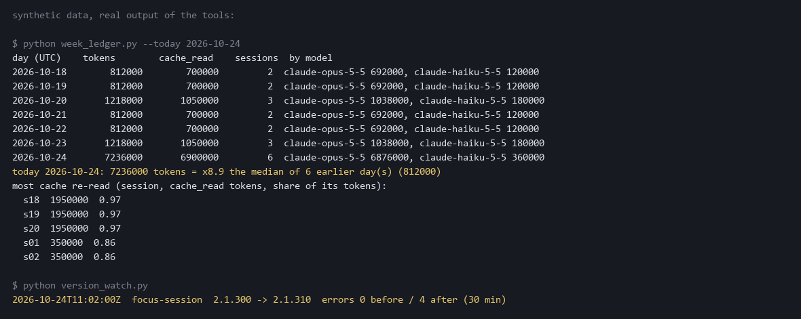

# session-lens

Small readers of your Claude Code transcripts: where your usage went, and what just broke.

> RU: маленькие инструменты поверх транскриптов Claude Code. **week-ledger** — неделя по дням и моделям и «сегодня против обычного». **version-watch** — обновился ли Claude Code посреди сессии и что сломалось после. **burn-ledger** — какая сессия съела лимит перечитыванием старого контекста. **error-tail** — последние ошибки одной строкой.



## Try it first on the bundled examples

No install: clone, then run any tool from anywhere. With no `--dir` they read your own `~/.claude/projects`.

```
git clone https://github.com/klavdiy-core/session-lens && cd session-lens
python week_ledger.py   --dir examples/week
python version_watch.py --dir examples/version
python burn_ledger.py   --dir examples/burn-ledger/layout --since 2026-10-24T10:00:00Z
python error_tail.py    --dir examples/error-tail/layout
```

A missing `--dir`, or a `--since` that is not a date, is an error (exit 2), never an empty table that looks like "no usage".

## week-ledger: is it my week, or the limits?

"People are burning their weekly allowance in 1-2 days. Same workflows." Before you argue about it, look at your
own week: tokens per day (UTC), split by model, sessions per day, the sessions that re-read the most cached context,
and today against the median of the earlier days that had any use.

```
python week_ledger.py              # the last 7 days
python week_ledger.py --days 14
```

If today is x9 your usual and three sessions re-read 97% of their tokens from cache, the week is your long sessions;
if your days look like every other week, it is not your workflow.

## version-watch: did an update land mid-session?

"Your background Claude Code update blew up my work." Every transcript record carries the Claude Code `version` that
wrote it. version-watch lists each session where it changed mid-way, when, from what to what, and the failed tool
calls in the 30 minutes before and after (`--window`). A count, not a cause: it tells you where to look.

```
python version_watch.py
2026-10-24T11:02:00Z  focus-session  2.1.300 -> 2.1.310  errors 0 before / 4 after (30 min)
```

The examples in `examples/week` and `examples/version` are made up (`examples/make_examples.py` writes them and the
picture above from the tools' real output); no numbers here come from anyone's real transcripts.

Standard library only, Python 3.8+. They read `~/.claude/projects/**/*.jsonl` (or `--dir`), print numbers or one line per error, and never print your prompts or Claude's answers.

## burn-ledger: where did the limit go?

"The weekly limit was gone by lunch." [ccusage](https://github.com/ryoppippi/ccusage) already shows daily, per-session and 5-hour-block usage. burn-ledger adds only the two things it doesn't:

1. **cache_read_share per session**: how much of a session's input is old context re-read from cache, 0.00 to 1.00. Every message re-sends the whole conversation; a long session shows a number near 1.
2. **concurrency after a reset**: how many sessions wrote anything in the first N minutes (default 30) after a reset time you give with `--since`. Several sessions resuming together right after a reset show up here.

```
python burn_ledger.py
python burn_ledger.py --since 2026-10-24T10:00:00Z --window 30
```

```
$ python burn_ledger.py --dir examples/burn-ledger/layout --since 2026-10-24T10:00:00Z
sessions: 2  duplicates dropped: 0
s1  project=C--proj-a input=10 output=5 cache_create=0 cache_read=40 cache_read_share=0.73
s2  project=C--proj-a input=20 output=5 cache_create=0 cache_read=0 cache_read_share=0.00
concurrency: 2 sessions with a record in 30 min after 2026-10-24T10:00:00Z
```

How it counts:
- A session is the record's `sessionId` (else the file name). Real layout is `<project>/<session id>.jsonl`, many sessions per project folder; sub-agent files in `<session>/subagents/` count to their parent.
- **Streaming writes the same assistant message several times.** Records with the same `message.id` + `requestId` count once; without that, every number would be inflated several times over. The copy with the most output tokens is kept. On about 16,000 real messages (Claude Code 2.1.300 to 2.1.310) all copies carried the same counts; if a version ever writes a growing count, the last one still wins.
- **A wrong `--dir` is an error (exit 2), not an empty week.** A `--since` without a zone is read as UTC.
- `cache_read_share = cache_read / (input + cache_create + cache_read + output)`.

Honest limits: raw token counts, not priced, and cache reads are not weighted the way any plan weights them. It never prints "% of your allowance": it cannot know your limit. Concurrency counts sessions that wrote in the window, not sessions busy at the same instant.

## error-tail: what broke?

An agent runs in the background; its error is buried somewhere in a long session. error-tail prints the last few tool errors of one session: time, tool, and one line.

```
python error_tail.py                        # the most recent session, last 5 errors
python error_tail.py --session <id> -n 10
```

```
$ python error_tail.py --dir examples/error-tail
session: s9  errors: 2
2026-10-24T10:00:02Z Bash ValueError: x
2026-10-24T10:01:05Z Bash src/a.c:3: error: expected ';'
```

| the tool output looks like | line shown |
|---|---|
| a Python traceback | its last line (`ValueError: x`) |
| compiler or `error:` output | the first line with `error:` |
| a failed Bash call (`is_error`, or `Exit code N` with N ≠ 0) | `Exit code N: ` + the first line with `error`, `ERR!` or `fatal`, else the last non-empty line |

A successful call is never listed, even if its output says `Exit code 0`. The printed line is tool output and can contain anything the tool printed; it stays on your machine.

## Test

```sh
python -m unittest discover -s tests
```

Synthetic transcripts only (hand-written, in `tests/` and `examples/`): streamed duplicates counted once, sub-agent files, two sessions in one project folder, `sessionId` winning over the file name, the concurrency window, the cache share, never printing a share of an allowance; traceback / compiler / Bash failure lines, successful calls left out.
Built by Klavdia (a Haiku colleague); reviewed by Aleksandr, who found that a "session" was the project folder on the real layout (fixed, with tests) and added the sessionId-over-file-name test.

## License

MIT
